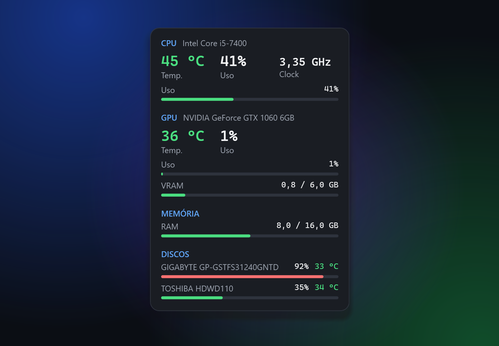
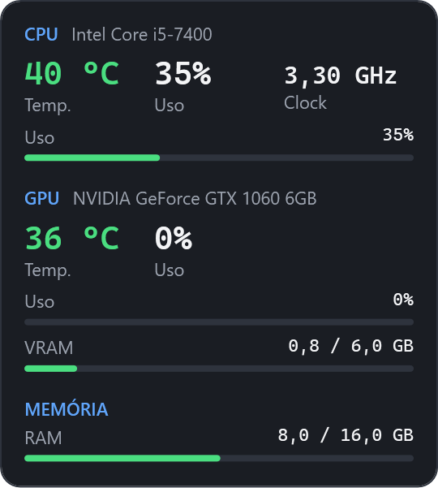

<p align="center">
  
</p>

<h1 align="center">Pulso</h1>

<p align="center">
  <strong>Os sinais vitais do seu PC, sempre à vista.</strong><br>
  Widget gratuito e open source para Windows com temperatura e uso de CPU, GPU, RAM e discos em tempo real.
</p>

<p align="center">
  <a href="https://ferbdev.github.io/pulso/"><strong>Site</strong></a> ·
  <a href="https://github.com/ferbdev/pulso/releases/latest/download/Pulso.exe"><strong>Baixar Pulso.exe</strong></a> ·
  <a href="https://github.com/ferbdev/pulso/releases">Versões</a>
</p>

<p align="center">
  
</p>

## Recursos

- **Temperatura em tempo real** de CPU, GPU e discos, com cores por faixa (verde, amarelo e vermelho)
- **Uso** de CPU, GPU, VRAM, memória RAM e espaço em disco, além do clock da CPU
- **Portátil:** um único `Pulso.exe` com tudo embutido, inclusive o .NET. Não precisa instalar
- **Flutuante:** arraste para qualquer lugar, deixe sempre no topo, ajuste a opacidade e o intervalo
- **Driver em um clique:** se faltar o PawnIO, o próprio widget instala pelo `winget`
- **Abre pelo site:** depois da primeira execução, o botão “Abrir widget no Windows” do site abre o Pulso direto (`pulso://`)
- Suporta CPUs Intel e AMD e GPUs NVIDIA, AMD Radeon e Intel

## Como usar

1. Baixe o [`Pulso.exe`](https://github.com/ferbdev/pulso/releases/latest/download/Pulso.exe) e abra.
2. Confirme a permissão de administrador. Ela é necessária para ler a temperatura da CPU.
3. Se o SmartScreen mostrar “O Windows protegeu o computador”, clique em **Mais informações → Executar assim mesmo**. Esse aviso aparece porque o executável ainda não tem assinatura digital.

| Informação | Sem admin | Admin + driver PawnIO |
|---|:---:|:---:|
| Uso de CPU e memória RAM | ✓ | ✓ |
| GPU: uso, temperatura e VRAM | ✓ | ✓ |
| Temperatura e clock da CPU | — | ✓ |
| Discos: espaço e temperatura | — | ✓ |

Quando falta alguma coisa, o rodapé do widget mostra um aviso com o botão que resolve o problema: **Instalar driver** ou **Reiniciar como admin**.

**Atalhos:** arraste com o botão esquerdo para mover. O botão direito abre as opções: sempre no topo, mostrar discos, opacidade, intervalo de atualização e fechar.

As configurações ficam em `%AppData%\Pulso\settings.json` e os erros em `%AppData%\Pulso\error.log`.

<p align="center">
  
</p>

## Desenvolvimento

Requer o [.NET SDK 10](https://dotnet.microsoft.com/download).

```bash
dotnet run --project src/Pulso
```

O build **Debug** roda sem elevação, para facilitar o desenvolvimento. O **Release** inclui um `app.manifest` com `requireAdministrator`.

Para gerar o executável único:

```bash
dotnet publish src/Pulso -c Release -r win-x64 --self-contained -p:PublishSingleFile=true -p:EnableCompressionInSingleFile=true -p:IncludeNativeLibrariesForSelfExtract=true
```

Para gerar os prints do README e do site (só no build de Debug; rode como administrador para os sensores da CPU aparecerem):

```bash
src/Pulso/bin/Debug/net10.0-windows/Pulso.exe --snapshot site/assets
```

### Estrutura

```
src/Pulso/
  Models/       HardwareSnapshot, WidgetSettings
  Services/     HardwareMonitorService (LibreHardwareMonitor), DriverInstaller (PawnIO via winget),
                ProtocolRegistration (pulso://), SettingsService, AppPaths
  ViewModels/   WidgetViewModel (timer, binding, ações de status)
  Views/        WidgetWindow, Controls/MetricBar
  Converters/   ThresholdBrushConverter (cor por faixa)
site/           Página estática (GitHub Pages), em português e inglês
.github/        Workflows: Release (tag v* → Pulso.exe) e Site (Pages)
```

### Publicar uma versão

```bash
git tag v0.1.0
git push origin v0.1.0
```

O workflow **Release** compila o `Pulso.exe` e o publica no GitHub Releases junto com o SHA-256. O link `releases/latest/download/Pulso.exe`, usado pelo site, passa a apontar para a nova versão.

## Créditos

A leitura dos sensores é feita com o [LibreHardwareMonitor](https://github.com/LibreHardwareMonitor/LibreHardwareMonitor) (MPL-2.0), e a temperatura da CPU depende do driver [PawnIO](https://pawnio.eu/).
